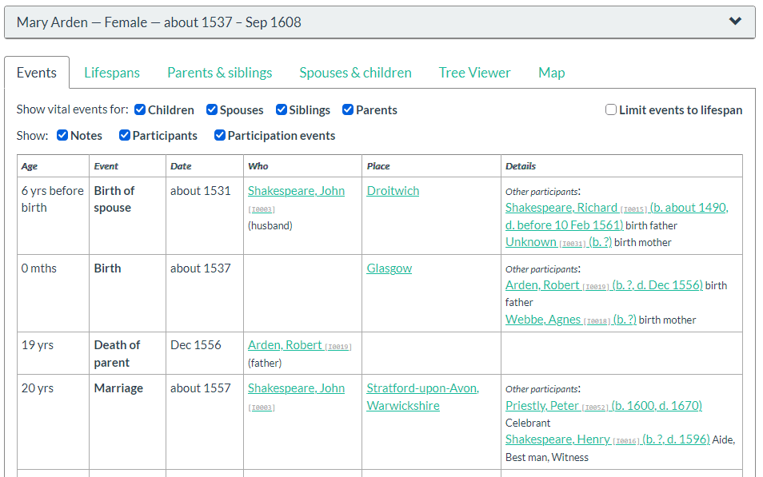
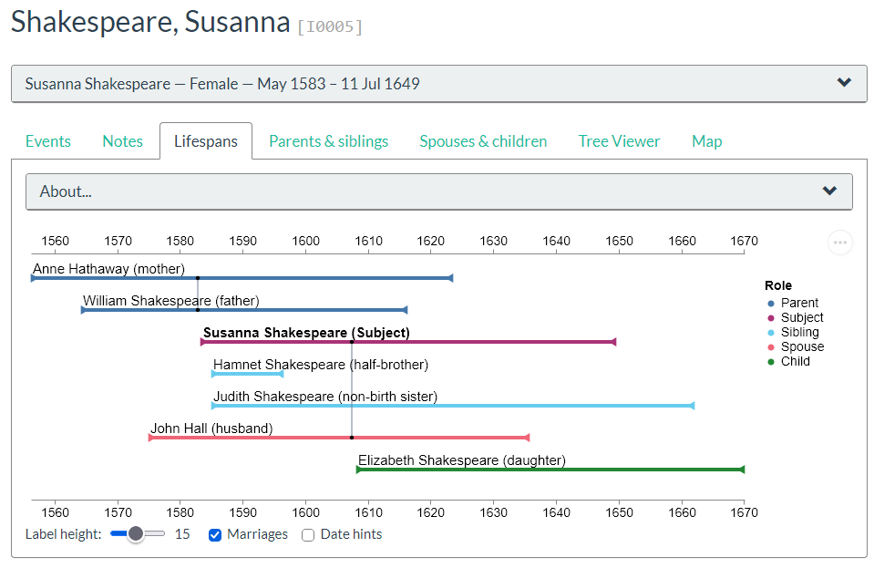

# Dynamic Web Extended

**Dynamic Web Extended (DWE)** is a Gramps report addon for creating
interactive genealogy websites.

It is derived from the Gramps **Dynamic Web Report (DWR)**, originally
developed by Pierre Bélissent and others. DWE retains the main features
and layout of Dynamic Web Report while adding additional ways of
presenting and exploring family-history information.

DWE is a separate addon and does not replace the standard Dynamic Web
Report. Both reports can be installed and used in Gramps.

### Help and documentation

Dynamic Web Extended includes the standard report options inherited from Dynamic Web Report (DWR), together with additional options and features introduced by DWE.

- **Standard report options:** See the [Gramps Dynamic Web Report documentation](https://gramps-project.org/wiki/index.php/Addon:DynamicWeb_report) for help with the original DWR options.
- **DWE additions and enhancements:** See the [DWE User Guide](docs/DWE_User_Guide.pdf) for explanations of the additional features, configuration options and changes introduced by Dynamic Web Extended.

**Current release: 0.3.8**

[Release history](CHANGELOG.md)

DWE has been tested with **Gramps 5.2.3** and **Gramps 6.0.8**.

## Main features

DWE adds a number of features to the standard Dynamic Web Report,
including:

- **Extended Events** — combines a person's own events with relevant
  events from parents, siblings, spouses and children to provide a
  chronological view of the family around them.

- **Event participants** — improved handling of witnesses, clergy and other participants,
  including their roles.

- **Lifespans** — a graphical display showing how the lives of a person
  and their immediate family overlap.

- **Tree Viewer** — an interactive graphical family-tree display using
  a bundled version of the Topola Genealogy Viewer.

- **Tracking** — shows how people in the website are related to one or
  more selected people.

- **Why Me** — allows the website creator to explain why a particular
  person has been included in the family tree.

- **Story** — provides a short introduction or summary near the top of
  a person's page.

- **Multiple-family clarity** — changes parts of the family display, making multiple families and less usual family
  structures easier to understand.

- **Markdown notes** — allows selected Gramps notes written in Markdown
  to be rendered as formatted content.

- **Local Labels** — allows selected labels in the generated website to
  be customised without modifying the program code.

- **Website themes** — the original Default and Mainz styles, plus five new
  Bootswatch themes: Cerulean, Flatly, Journal, Readable and United.

- **Theme selection** — visitors can change the website's appearance using the available styles.

- **Statistics and notable records** — explore interesting records, including ages, marriages, children, and family, with a visitor-selectable result count.

- **Quick Guide** — provides a guide within the generated website, with an editable Markdown source that allows the website creator to customise instructions for visitors.


DWE also includes a number of smaller enhancements to relationships,
events, place names, indexes and other parts of the generated website.

## Examples of DWE features

The following screenshots illustrate two of the additional ways DWE presents family-history information.

### Extended Events

The Extended Events display combines a person's own events with relevant events from parents, siblings, spouses and children, providing a chronological view of the family around them.



### Lifespans

The Lifespans display provides a graphical comparison of the lives of a person and their immediate family, making it easier to see which family members were alive at the same time.



## Installation through Gramps Addon Manager

Dynamic Web Extended is available for Gramps 5.2 and Gramps 6.0.

To install:

1. Open Gramps and select **Tools → Addon Manager**.
2. Add a new addon project (you could name it DWE) using the URL appropriate to your Gramps version:

   **Gramps 5.2**
   ```
   https://raw.githubusercontent.com/johnvitlin/DWE-Addons/main/gramps52
   ```

   **Gramps 6.0**
   ```
   https://raw.githubusercontent.com/johnvitlin/DWE-Addons/main/gramps60
   ```

3. Refresh the available addons if necessary.
4. Find **Dynamic Web Extended** in the addon list and install it.
5. Restart Gramps if prompted.

The report is available under **Reports → Web Pages → Dynamic Web Extended**.

The distribution files and user documentation are maintained at:

https://github.com/johnvitlin/DWE-Addons

## Creating a website

Open the required family tree in Gramps and select:

**Reports → Web Pages → Dynamic Web Extended**

Choose the destination directory, select the people to include and set
the required report options.

DWE inherits most of its report options from Dynamic Web Report and
adds a **DWE Options** page for its additional features.

Select **OK** to generate the website.

The resulting directory contains the HTML, JavaScript, data and other
files that make up the website. Keep the generated directory and its
subdirectories together.

The website can then be copied to a web server for publication or
viewed locally.

Each generated website also includes an **About** page. This identifies
the versions of Dynamic Web Extended and Gramps used to generate the
website and provides brief information about DWE.

## Viewing a report locally

This section applies only to websites on a local computer.

A generated DWE website can be opened directly on a computer by opening `index.html`,
but some features cannot operate correctly.

In particular:

- Tree Viewer cannot operate when the report is opened directly from
  the file system.
- OpenStreetMap maps do not display correctly in this mode.

On Windows, every generated DWE report includes a file called:

    View report locally.bat

Double-click this file to start a small local web server that opens the
DWE home page in a browser. Leave the command window open while
viewing the website.

The local web server runs only on your computer, and your report data
is not uploaded to the internet. Features that obtain information from
external services, such as OpenStreetMap map tiles, still require an
internet connection.


## Tree Viewer and Topola

DWE's Tree Viewer uses a bundled version of the **Topola Genealogy
Viewer**.  Topola viewer is written and maintained by Przemek Więch @PeWu.

When **Include Tree Viewer** is selected, DWE generates the genealogical
data required by the viewer and includes the bundled viewer in the
generated website.

The Tree Viewer is therefore self-contained within the generated DWE
website. Website visitors do not need to install Topola, visit the
Topola website, or provide a separate GEDCOM file.

## Markdown support

DWE can render selected Gramps notes using Markdown.

Markdown processing can be enabled using:

- the `MD` marker at the beginning of a note;
- a selected Markdown note type; or
- the option to treat ordinary notes as Markdown.

Gramps styled-note formatting is retained, allowing styled Gramps
content and Markdown to be used together where appropriate.

## Support and feedback

Questions, bug reports and suggestions about Dynamic Web Extended are welcome on the Gramps Discourse forum.

Please include **Dynamic Web Extended** or **DWE** in the topic title so that discussions can be found easily.

GitHub is used primarily for maintaining the source code and releases.

## Development

Dynamic Web Extended is maintained as a Git repository.

Source repository:

https://github.com/johnvitlin/DynamicWebExtended

DWE is derived from the Gramps Dynamic Web Report and continues to use
much of its report architecture.

Development changes are tested by generating and viewing reports.
Reports containing features such as Tree Viewer should be tested
through a web server rather than solely through `file://` URLs.

## Authors

Dynamic Web Extended is derived from Dynamic Web Report, originally
developed by **Pierre Bélissent** and other Gramps contributors.

Dynamic Web Extended additions and continuing development:

**John Vitlin**

## Licence

Dynamic Web Extended is free software and is distributed under the
GNU General Public License, version 2 or (at your option) any later
version.

The full licence text is available in [docs/license-gpl-2.0.txt](docs/license-gpl-2.0.txt).

DWE includes bundled third-party components. Their respective licence
files are included with those components.